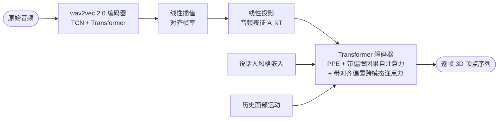

# 范例：FaceFormer

按 template.md 写成的一份笔记，步骤一两题都答「无」，所以没有「针对关注点」和「对比」两节，「限制」顺延为第 5 节。第四节里的 assets/table_main.png 是从 PDF 裁出的 Table 1 截图；用户研究两张表只在「其他实验」里带过。

---

# 论文分享：FaceFormer —— 让 3D 人脸跟着语音开口说话

来源：arXiv:2112.05329（香港大学・Adobe Research・香港科技大学，2022-03-17）

论文：https://arxiv.org/abs/2112.05329

代码 / 演示：https://evelynfan.github.io/audio2face/

## 1. 一句话解释做了什么

输入一段语音和一张不动的 3D 人脸模型，输出这张脸随着语音逐帧开口、闭嘴、动表情的 3D 动画。相当于给任何 3D 角色装上一张会跟着声音说话的脸。

## 2. 背景、痛点与方法

### 背景

- 游戏、VR 和影视里的 3D 角色需要跟着语音自动做口型和表情；2D 说话人头视频生成的是像素，不能直接驱动 3D 模型。
- 配对的「语音 + 3D 面部动捕」数据极少，因为 3D 动捕采集昂贵费时。

### 痛点

- 主流网格方法（VOCA 等）只看一小段音频窗口的音素特征，上下文不够，口型会不准，上半张脸的表情有歧义。
- MeshTalk 建模了长上下文，但用 Mel 频谱特征，数据稀缺时口型仍不准；直接套 vanilla Transformer 又数据饥饿。
- vanilla Transformer 的正弦位置编码泛化不到比训练更长的序列，默认的 encoder-decoder 注意力也对不齐「音频帧」和「动画帧」两种模态。

### 方法

FaceFormer 用一个 Transformer 编码器-解码器自回归模型，一次看到整段音频的长上下文和已经生成的历史面部运动，逐帧预测 3D 网格顶点。音频编码器直接复用自监督预训练的 wav2vec 2.0，解码器针对长序列泛化和跨模态对齐改了两处注意力设计。

### 创新点

- **预训练 wav2vec 2.0 音频编码器**：它在海量无标注语音上学到了音素信息，弥补 3D 配对数据不足（回应痛点 2），编码器自注意力不受限，天然提供长音频上下文（回应痛点 1）。
- **周期位置编码（PPE）加带时间偏置的因果自注意力**：位置编码按周期 $p$ 取模，注意力偏置为 $\lfloor (i-j)/p \rfloor$ 乘以各头固定斜率，是 ALiBi 的广义形式（$p=1$ 即 ALiBi），让模型泛化到超过训练长度的序列（回应痛点 3 前半）。
- **带对齐偏置的跨模态注意力**：第 $i$ 个动画帧只允许关注第 $ki$ 到 $k(i+1)$ 个音频 token，显式把两种模态按时间对齐（回应痛点 3 后半）。

## 3. 整体架构

- **音频编码器**：输入原始波形，TCN 提取局部特征后过 Transformer，输出音频 token 序列；权重用预训练 wav2vec 2.0 初始化，TCN 部分冻结。
- **插值与投影**：音频特征率 $f_a$ 高于动画帧率 $f_m$，按 $k = \lceil f_a / f_m \rceil$ 线性插值到 $kT$ 长度再线性投影，让音频 token 数恰为动画帧数 $T$ 的 $k$ 倍。
- **解码器**：上一帧顶点经 FC 投影后加上说话人 one-hot 风格嵌入 $s_n$，再加 PPE；先过带时间偏置的因果自注意力建模运动时序，再过带对齐偏置的跨模态注意力从音频表征取信息，最后 FC 投影回顶点空间。
- **推理**：自回归逐帧生成；换 one-hot 身份即换说话风格；未见说话人用全部训练身份分别条件化。

### 训练与数据

训练用自回归方式而非 teacher forcing（作者称弱引导比全引导效果更好），损失是预测顶点与真值顶点的 MSE。TCN 冻结，其余可训练，100 个 epoch，周期 $p$ 在 BIWI 上取 25、VOCASET 上取 30。数据集 BIWI（14 人、25 fps，用情绪语境子集，训练 6 人 192 句）和 VOCASET（12 人、60 fps、480 段），基线是 VOCA 官方代码和作者复现的 MeshTalk。

## 4. 评价指标

- **口型顶点误差（LVE）**：每帧嘴唇区域顶点与真值的最大 L2 距离再对全部帧取平均，单位 $\times 10^{-4}$ mm，越低越好。
- **A/B 偏好率**：AMT 评测者在两段动画中偏好本方法的百分比，分真实感与口型同步两项，越高越好。

### 主指标（Table 1，BIWI-Test-A，LVE）

FaceFormer 口型误差最低，比 VOCA 低约 30%，比 MeshTalk 低约 20%；/b/、/m/、/p/ 这类双唇音能正确闭口。

### 消融

论文只给定性结果，没有消融数字表。去掉编码器 Transformer 只留 TCN，嘴常闭不上且口部抖动；不加载 wav2vec 2.0 预训练权重，口型不同步并抖动；解码器换成 FC 或 LSTM，口型稳定性和时序连贯性下降；去掉跨模态对齐偏置，全脸表情「哑化」；用原始正弦位置编码，静音帧口部抖动且测试音频越长越差；只用 ALiBi 不用 PPE，BIWI 无变化但 VOCASET 上表情很快冻结不动。

### 其他实验

用户研究（Table 2、3）：对 VOCA 和 MeshTalk 的偏好率都在 77% 到 84% 之间，对真实动捕数据只有 29% 到 37%，与真人仍有差距。长序列泛化：在 15 段约 20 秒的 TED 音频上，PPE 加时间偏置相对原始正弦位置编码的偏好率为真实感 57.78 ± 16.78%、口型同步 62.22 ± 10.18%。

## 5. 限制

- 自注意力的二次方时间和内存复杂度是主要瓶颈，当前不适合实时应用。
- 依赖 3D 扫描采集的数据，规模小；对未见过的说话人，推理时只能借训练集里的身份做条件。
- 作者提醒该技术可以用任意音频驱动逼真人脸，可能被滥用，呼吁负责任使用并尊重被扫描演员的授权。
- 补充（非作者所述）：消融全是定性描述，唯一的量化指标只在已见说话人上测，MeshTalk 基线是作者复现并缩减过的，结论的可比性有限。
- 作者提出的后续方向：借鉴 Linformer、Longformer 等高效注意力降低复杂度，走向实时。

\#论文分享 #语音驱动3D面部动画 #Transformer #FaceFormer
